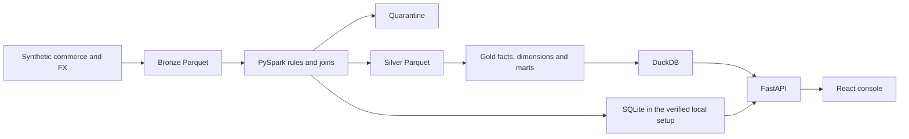
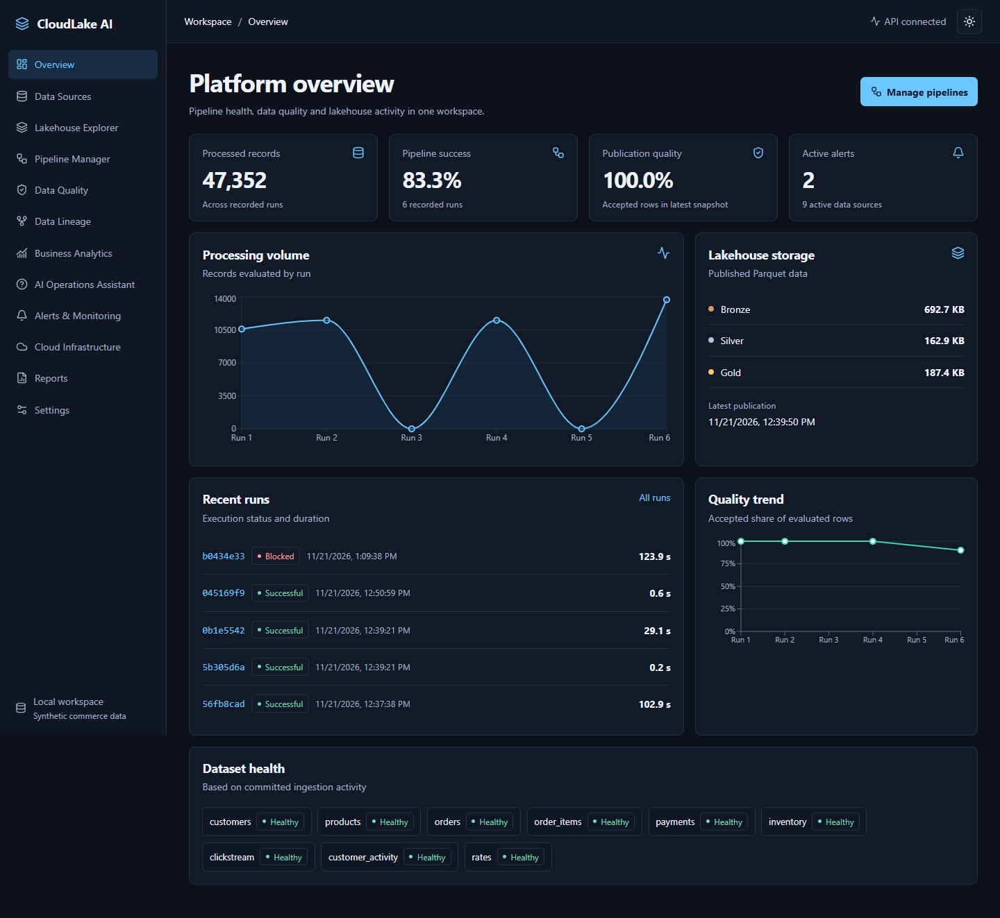

# CloudLake AI

**Cloud-native data engineering, intelligent analytics and pipeline observability**

CloudLake AI is Faizan Akhtar’s portfolio project for a synthetic commerce data platform. It processes nine commerce and FX feeds, enforces quality rules before analytical publication and exposes run history, business metrics and operational evidence in a React console.



The source generator is deterministic. Bronze records carry provenance. Silver normalizes types, checks reference integrity and records quarantine reasons. Gold serves fixed DuckDB queries for sales, margin, channel, geography, and other published models. The offline assistant returns evidence links from the same data. The AWS configuration covers a separate S3, Glue, Athena and event-driven data plane. See [status](PROJECT_STATUS.md) for verification evidence and limitations.



See the [screenshots](docs/screenshots/), [sample PDF](docs/sample-cloudlake-report.pdf), [CSV export](docs/sample-cloudlake-report.csv) and [Excel export](docs/sample-cloudlake-report.xlsx).

The sample reports show quality counts for the published snapshot and for the blocked candidate linked to the quality-gate and schema-drift alerts. Both scopes use stored run IDs.

## Technology stack

| Layer | Tools |
| --- | --- |
| Ingestion and processing | Python, PySpark, Apache Arrow and Parquet |
| Analytical serving | DuckDB and an optional local Apache Iceberg catalog |
| API and operational metadata | FastAPI, SQLite and Alembic |
| Operations console | React, TypeScript and Vite |
| Optional infrastructure configuration | Airflow DAGs, Docker Compose, Terraform for AWS, and GitHub Actions |

## Start locally on Windows

Install Python 3.11–3.13, Java 17 and Node 20.19+ or 22.12+. Run these from the project directory.

```powershell
python -m venv .venv
.\.venv\Scripts\python.exe -m pip install -r backend/requirements.txt -r backend/requirements-spark.txt
npm.cmd --prefix frontend ci
.\.venv\Scripts\python.exe -m data_engineering.cli generate --profile demo
.\.venv\Scripts\python.exe -m data_engineering.cli run
```

Open two PowerShell windows. Start the API in one and Vite in the other.

```powershell
.\scripts\start-local.ps1 api
.\scripts\start-local.ps1 web
```

Open [the dashboard](http://127.0.0.1:5173), [the OpenAPI UI](http://127.0.0.1:8000/docs) or [API readiness](http://127.0.0.1:8000/ready). Press Ctrl+C in each service window to stop the servers. The default local database and lake are under `.runtime`. On Windows, consult [the troubleshooting guide](docs/TROUBLESHOOTING.md) if the Spark launcher needs Hadoop utilities, temporary directory configuration or local socket access.

## Incremental processing

```powershell
.\.venv\Scripts\python.exe -m data_engineering.cli generate --profile demo --batch 1
.\.venv\Scripts\python.exe -m data_engineering.cli run --mode incremental
.\.venv\Scripts\python.exe -m data_engineering.cli monitor
```

The manifest suppresses repeated source content, and incremental runs with no new content finish without publishing a new snapshot. When input changes, the pipeline rebuilds consistent Silver and Gold snapshots from the committed Bronze journal. Files arriving before the event watermark are evaluated and retained when valid. The current engine recomputes whole snapshots and materializes local source files during discovery.

## Optional infrastructure

The Compose configuration defines the API and web console plus an optional `infrastructure` profile for PostgreSQL and MinIO. Terraform and Compose configuration checks passed locally. AWS deployment, Airflow execution, PostgreSQL, MinIO, Docker runtime, and GitHub-hosted CI were unverified at the time of the local audit. Current hosted workflow results are available in the repository’s Actions tab after publication. Local operation requires no cloud credentials. [Quickstart](docs/QUICKSTART.md) · [AWS deployment guide](docs/AWS_DEPLOYMENT.md)

## Benchmark results

| Measured run | Records evaluated | Duration |
| --- | ---: | ---: |
| Demo batch | 10,594 | 69.49 s |
| Standard batch | 105,683 | 203.53 s |
| Changed incremental | 11,524 | 102.93 s |
| Unchanged incremental | 0 | 0.18 s |

The changed incremental run staged 930 new records. It reconciled with the full replay at USD 1,360,238.67 in recognized revenue. The unchanged run retained the published snapshot. [Benchmark details and raw evidence](docs/BENCHMARKS.md)

## Verification

The final local audit recorded 12 passing Python tests, one Airflow skip, and 3 passing frontend tests. Ruff, TypeScript, the Vite production build, Terraform and Compose validation passed. Chrome exercised all 12 dashboard routes, and the API returned all 18 report export combinations. [Final audit](docs/FINAL_DELIVERY.md)

```powershell
.\.venv\Scripts\python.exe -m pip install -r backend/requirements-dev.txt
.\.venv\Scripts\python.exe -m pytest -q
.\.venv\Scripts\python.exe -m ruff check backend data_engineering orchestration aws evaluation/scripts scripts
npm.cmd --prefix frontend test
npm.cmd --prefix frontend run build
```

[Benchmark methodology and results](docs/BENCHMARKS.md) describe the recorded machine, data sizes and measured tradeoffs. The [security model](docs/SECURITY.md) covers the trusted local control plane, uploads, controlled jobs and bounded reads. Consult [metric definitions](docs/METRIC_DEFINITIONS.md) when interpreting amounts, partial date ranges and sample FX rates.

See the [architecture](docs/ARCHITECTURE.md), [case study](docs/CASE_STUDY.md), [API reference](docs/API_REFERENCE.md), [source dictionary](docs/DATA_DICTIONARY.md), [lineage](docs/DATA_LINEAGE.md) and [implementation status](PROJECT_STATUS.md).

[Final audit report](docs/FINAL_DELIVERY.md) · [GitHub publication checklist](docs/PUBLICATION_CHECKLIST.md) · [SHA-256 manifest](PUBLICATION_MANIFEST.json)

**Project owner** · Faizan Akhtar (Faizan-AiEngineer). Commerce data is synthetic. The seeded FX values are illustrative. Project licensing is pending owner approval.
