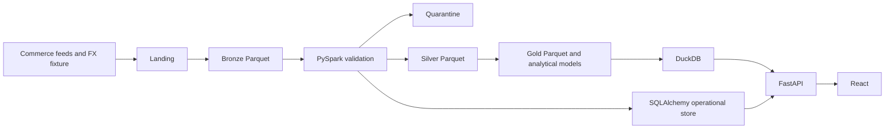
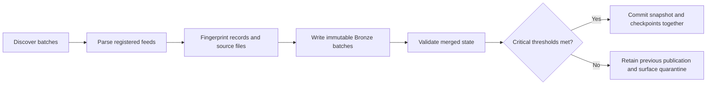
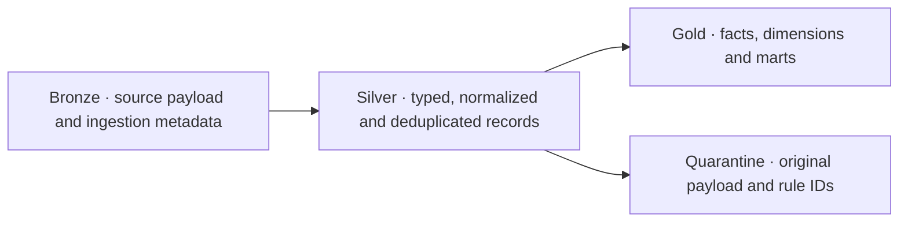
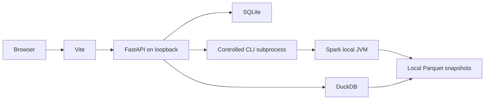
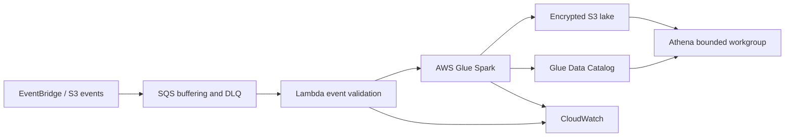
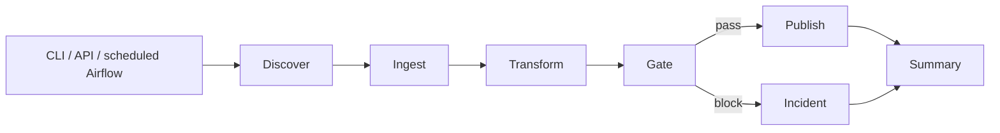
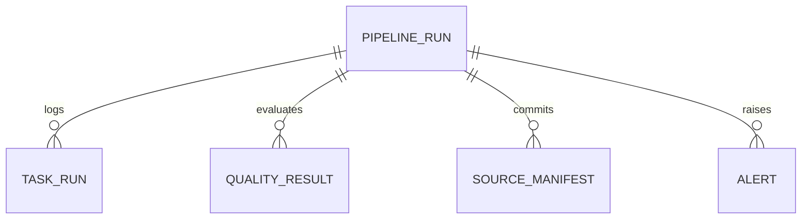
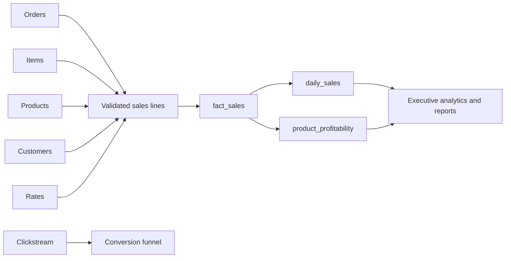

# CloudLake AI architecture

CloudLake AI models a synthetic commerce business. The core processing path is local and offline. The application reads committed lake snapshots and operational metadata. AWS is a separately configured deployment target.

## Ingestion and publication

The metadata store acts as the publication authority. Files under a run ID are immutable. A completed transaction selects the visible run and records its source manifest. Retried inputs use content digests. Incremental discovery hashes inputs and skips staging unchanged content. Changed inputs trigger a full analytical rebuild from the Bronze journal to preserve cross-dataset consistency. Watermarks describe observed event time. File discovery accepts late data even when it precedes the watermark.

## Execution environments

SQLite is the verified local metadata store and the Compose default. The optional infrastructure profile defines PostgreSQL and MinIO, with PostgreSQL selected through the database URL. The DAG definitions target Airflow on Linux or WSL and invoke the pipeline in a distinct process. Docker Engine, PostgreSQL, MinIO and Airflow execution remain unverified. An Iceberg catalog can be enabled independently of the default Parquet snapshot workflow.

The AWS diagram describes the prepared target configuration. Terraform validation passed locally. Live AWS deployment remains unverified. The local API and control plane are designed for trusted single-user sessions.

## Orchestration and metadata

The API is versioned under `/api/v1`. It exposes typed run initiation, fixed analytical queries, paginated operational listings, bounded dataset previews, evidence-grounded assistant responses and report downloads. `/health` checks process liveness. `/ready` checks the operational store.

The React shell provides Overview, Data Sources, Lakehouse Explorer, Pipeline Manager, Data Quality, Data Lineage, Business Analytics, AI Operations Assistant, Alerts & Monitoring, Cloud Infrastructure, Reports and Settings.

The executive report reads revenue and source counts for the current publication. Its quality table also covers blocked runs referenced by recent run history or the included alerts. Alert rows identify the associated run and its status. Each quality total counts individual rule evaluations, which can exceed the number of quarantined rows.

## Analytical lineage

